 

---

### `> whoami`

I build and deploy practical web applications and developer tools. I work across **React, Next.js, TypeScript, Python, FastAPI, and PostgreSQL**: interfaces, APIs, databases, troubleshooting, and deployment.

My main focus is **full-stack development**. I've also worked with AWS, Docker, Terraform, and GitHub Actions in projects. I'm open to Full-Stack and Software Developer roles, and interested in IT Support opportunities that involve technical troubleshooting.

### `> stack --list`

### `> projects --featured`

| Product | What I built | Explore |
| :--- | :--- | :--- |
| **📊 StatFlare** | Analytics, website monitoring, and useful web tools. Next.js, TypeScript, FastAPI, PostgreSQL. | [Live site ↗](https://statflare.in/) |
| **🛍️ SortedChoice** | Product discovery with browsing, search, authentication, and reviews. Next.js, FastAPI, Supabase. | [Live site ↗](https://sortedchoice.com/) |
| **📚 JG Blogs** | Multilingual articles and learning resources in English, Hindi, and Marathi. Next.js and TypeScript. | [Live site ↗](https://www.jgblogs.com/) |
| **💻 DevFlow** | Windows desktop developer tool for local workflows and logs; still in development. Tauri, Rust, React. | [Source ↗](https://github.com/Jayeshgavit/DevFlow) |
| **🛡️ FraudShield** | Collaborative fraud detection application with React, Node.js, Python, and PostgreSQL. | Collaborative project |

### `> github --activity`

### `> contributions --animate`

<picture>
  <source media="(prefers-color-scheme: dark)" srcset="https://raw.githubusercontent.com/Jayeshgavit/Jayeshgavit/output/github-contribution-grid-snake-dark.svg" />
  <source media="(prefers-color-scheme: light)" srcset="https://raw.githubusercontent.com/Jayeshgavit/Jayeshgavit/output/github-contribution-grid-snake.svg" />
  
</picture>

---

**Have a role or a project in mind?** [Explore my portfolio](https://www.jayeshgavit.in/) · [Connect on LinkedIn](https://www.linkedin.com/in/jayesh-gavit-47ni/)

